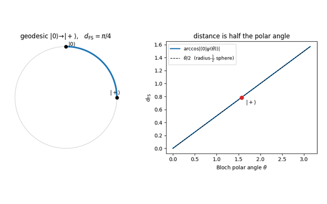

{width=60% fig-align=center fig-alt="Mathematical Foundations"}

Every later part averages some function of a random unitary, and to state
what is being averaged one needs density matrices for the states, completely
positive maps for the noisy evolutions, and a precise meaning for the word
random. This part assembles that vocabulary from elementary pieces. The Lie
algebras $\mathfrak{u}(D)$ and $\mathfrak{su}(D)$ are built from commutators and
the matrix exponential, the geometry of pure states from the Fubini-Study
metric, and the notion of a uniform distribution on $U(D)$ from enough measure
theory to make $\sigma$-additivity and measurability concrete. No prior exposure
to Lie groups is assumed.

Two constructions do most of the later work. The Choi-Jamiołkowski isomorphism
turns a quantum channel into a state on a doubled Hilbert space, converting
questions about maps into questions about matrices. Schur-Weyl duality
identifies the operators that commute with $U^{\otimes k}$ for every $U$ with the
algebra generated by permutations of the $k$ copies, which is why Haar averages
over many entries collapse onto a small number of permutation terms. The
notebooks work the $k=2$ case in full, where the only operators in play are the
identity and the SWAP.

One point deserves early emphasis. Closing a set of generators under repeated
commutators produces the dynamical Lie algebra, and whether that algebra fills
out all of $\mathfrak{su}(D)$ or stays inside a subalgebra decides both whether a
gate set is universal and how fast an operator can grow under the dynamics of
later chapters.

## Notebooks in this part

::: {.nb-item}
[Bloch-sphere geodesics & the Fubini-Study metric](../notebooks/ch1/solution_ch1_fubini_study.ipynb)

The natural distance between pure states.
:::

::: {.nb-item}
[Entanglement of a parametric two-qubit state](../notebooks/ch1/solution_ch1_entanglement_parametric.ipynb)

How entanglement tracks a tunable coupling.
:::

::: {.nb-item}
[The depolarizing channel](../notebooks/ch1/solution_ch1_depolarizing_channel.ipynb)

Kraus operators, complete positivity, and entanglement fidelity.
:::

::: {.nb-item}
[Dynamical Lie algebra of a three-qubit Ising chain](../notebooks/ch1/solution_ch1_dla_closure.ipynb)

Building an algebra by repeated commutators, and why parity alone does not explain its fifteen dimensions.
:::

::: {.nb-item}
[Schur-Weyl duality for $k=2$](../notebooks/ch1/solution_ch1_schur_weyl.ipynb)

The symmetric/antisymmetric split and the SWAP operator.
:::

::: {.nb-item}
[Choi matrix of amplitude damping](../notebooks/ch1/solution_ch1_choi_amplitude_damping.ipynb)

Channels as states via Choi-Jamiołkowski.
:::

::: {.nb-item}
[Unitaries that commute with a Hamiltonian](../notebooks/ch1/solution_ch1_dim_lie_algebra.ipynb)

Counting the commutant: a torus for a non-degenerate spectrum, $\sum_k d_k^2$ dimensions with degeneracies.
:::

::: {.nb-item}
[Surjectivity of the exponential map](../notebooks/ch1/solution_ch1_exp_surjectivity.ipynb)

Why every unitary is an exponential.
:::

::: {.nb-item}
[Haar invariance on $U(1)$](../notebooks/ch1/solution_ch1_haar_measure_unitary_group_rank_one.ipynb)

What "uniformly random unitary" means, in the simplest case.
:::

::: {.nb-item}
[Geodesic length & the quantum speed limit](../notebooks/ch1/solution_ch1_quantum_speed_limit.ipynb)

How fast a state can change.
:::

::: {.nb-item}
[Sectional curvature on $SU(3)$](../notebooks/ch1/solution_ch1_sectional_curvature.ipynb)

Planes of curvature $0$, $\tfrac12$ and $\tfrac18$, and which nearby evolutions reconverge fastest.
:::

::: {.nb-item}
[Differential geometry of state space](../notebooks/ch1/solution_ch1_differential_geometry_hilbert_space.ipynb)

The quantum geometric tensor, Berry curvature, and the Fubini-Study metric together.
:::

::: {.nb-item}
[Measure-theory basics](../notebooks/ch1/solution_ch1_measure_theory_basics.ipynb)

Lebesgue vs counting measure and $\sigma$-additivity.
:::

::: {.nb-item}
[Borel $\sigma$-algebras & measurability on $U(D)$](../notebooks/ch1/solution_ch1_borel_measurability.ipynb)

Making "random" rigorous.
:::

::: {.callout-tip appearance="simple"}
**Where to start.** If you only want the tools used later, do *Schur-Weyl
duality*, *Haar invariance*, and *the depolarizing channel* first, everything in
Part 3 builds directly on them.
:::
