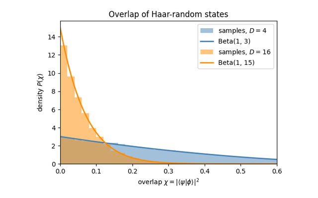

{width=60% fig-align=center fig-alt="Haar Measure & Weingarten Calculus"}

Most of the quantitative statements in this subject are averages over the unitary
group. One asks for the mean of a polynomial in the entries of a random unitary, the
entanglement of a state prepared by a random circuit, the variance of a cost-function
gradient, the fidelity that survives a noisy gate. In each case the hard-looking object
is a low moment of the **Haar measure**, the unique distribution on $U(d)$ invariant
under left and right multiplication. The **Weingarten calculus** is what turns these
averages into arithmetic.

The mechanism rests on one representation-theoretic fact. Averaging $k$ copies of $U$
produces an operator that commutes with $U^{\otimes k}$ for every $U$, so it lies in the
commutant of the $k$-fold representation. Schur-Weyl duality identifies that commutant
with the algebra generated by permutations of the $k$ tensor factors. An integral over a
continuous group therefore collapses to a finite sum over the symmetric group $S_k$,
with coefficients supplied by the Weingarten function. For the second moment the only
permutations are the identity and the swap, and a surprising amount of the later material
follows from that single case.

Three consequences are worth isolating before the notebooks. The first moment is a
twirl, sending any operator to its normalized trace times the identity, which is the precise sense
in which a uniformly random rotation erases everything but the trace. The second moment
produces purities, frame potentials, and the Page formula for the entanglement of a
typical pure state. Concentration of measure then upgrades these averages from typical to
overwhelming, so that in high dimension a single random state already behaves like the
whole ensemble. The factor $1/d$ that fixes the mean purity is the same one that
reappears later as the variance of a barren-plateau gradient, which is the thread running
from this part to quantum machine learning.

## Notebooks in this part

::: {.nb-item}
[The first Haar moment (twirling)](../notebooks/ch3/solution_ch3_weingarten_first_moment.ipynb)

Averaging an operator to its normalized trace times the identity.
:::

::: {.nb-item}
[The SWAP trick](../notebooks/ch3/solution_ch3_swap_trick.ipynb)

Turning purity into a two-copy expectation value.
:::

::: {.nb-item}
[Overlaps of random states](../notebooks/ch3/solution_ch3_haar_overlap.ipynb)

The distribution of $|\langle\psi|\phi\rangle|^2$ and its moments.
:::

::: {.nb-item}
[Fourth moment of the trace](../notebooks/ch3/solution_ch3_fourth_moment_trace.ipynb)

A warm-up: $\mathbb{E}|\mathrm{Tr}\,U|^4 = 2$.
:::

::: {.nb-item}
[Weingarten calculus as tensor networks](../notebooks/ch3/solution_ch3_tensor_weingarten_calculus.ipynb)

Diagrammatic contractions, including the third trace moment.
:::

::: {.nb-item}
[The Page formula](../notebooks/ch3/solution_ch3_page_formula.ipynb)

Average entanglement of a random state, via Marchenko-Pastur.
:::

::: {.nb-item}
[Concentration of purity](../notebooks/ch3/solution_ch3_purity_concentration.ipynb)

Why a random subsystem is almost exactly maximally mixed.
:::

::: {.callout-important appearance="simple"}
The single most reused result in this tutorial is the **second-moment twirl**
$\mathbb{E}_U[U^{\otimes 2}\,X\,U^{\dagger\otimes 2}] = c_{\mathbb{I}}\,\mathbb{I} + c_{\mathbb{F}}\,\mathbb{F}$.
If you internalize one calculation, make it this one.
:::
