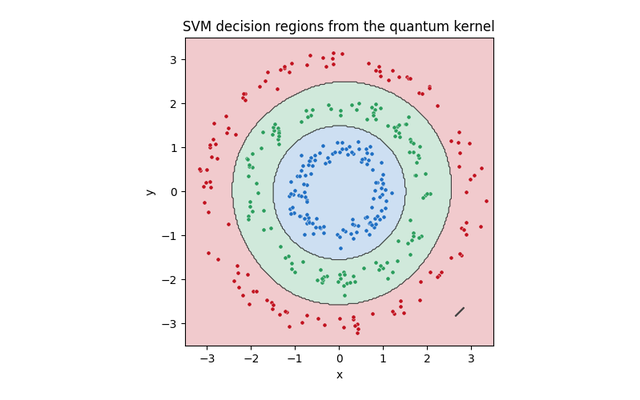

{width=60% fig-align=center fig-alt="Quantum Machine Learning"}

A variational quantum circuit is trained by following the gradient of a cost
function, which works only when that gradient is large enough to estimate from a
realistic number of measurements. Once the circuit is expressive enough to form
an approximate $2$-design over its parameters, the Haar second moment from
Part 3 forces the variance of every gradient component to shrink
exponentially in the qubit count. This is the barren plateau, where the landscape
is flat to within sampling noise and gradient-based optimization has no direction
to follow.

The same second-moment estimate identifies what restores a usable gradient.
Local cost functions, restricted symmetry sectors, and shallow circuit blocks all
keep the ensemble short of a full $2$-design and recover a variance that decays
only polynomially. The plateau reappears under other names with one origin.
Quantum kernel entries concentrate around a fixed value and lose the structure a
kernel method relies on, the quantum Fisher information matrix flattens in the
metrology reading of the same collapse, and generative and reservoir models, from
Born machines to extreme learning machines and reservoir computers, push their
output distributions toward Porter-Thomas statistics so that the informative
signal concentrates away.

The operative tension is that scrambling supplies expressivity while removing
trainability, so the workable regime is a structured ensemble that stops short of
Haar randomness.

## Notebooks in this part

::: {.nb-item}
[Barren plateaus](../notebooks/ch7/solution_ch7_barren_plateau.ipynb)

Gradient variance vanishing exponentially with qubit number.
:::

::: {.nb-item}
[Local vs global cost functions](../notebooks/ch7/solution_ch7_local_vs_global_cost.ipynb)

How observable locality rescues trainability.
:::

::: {.nb-item}
[Barren plateaus via quantum Fisher information](../notebooks/ch7/solution_ch7_barren_plateau_quantum_fisher_information.ipynb)

The metrology view of the same collapse.
:::

::: {.nb-item}
[Quantum kernel concentration](../notebooks/ch7/solution_ch7_quantum_kernel_concentration.ipynb)

Why over-expressive kernels become uninformative.
:::

::: {.nb-item}
[Born-machine expressivity](../notebooks/ch7/solution_ch7_born_machine.ipynb)

Concentration of a generative model's output distribution.
:::

::: {.nb-item}
[QELM feature concentration](../notebooks/ch7/solution_ch7_quantum_extreme_learning_machine_concentration.ipynb)

Feature collapse in quantum extreme learning machines.
:::

::: {.nb-item}
[Quantum reservoir computing](../notebooks/ch7/solution_ch7_quantum_reservoir_computing_injection.ipynb)

Injection contractivity and restarting overhead.
:::

## Worked examples

Five end-to-end examples where a fixed scrambling feature map extracts the
features and only a linear readout is trained. Each one states where it works and
where it breaks.

::: {.nb-item}
[Quantum-kernel classification of concentric rings](../notebooks/ch7/example_ch7_quantum_kernel_rings.ipynb)

A fidelity kernel and a soft-margin classifier, with the onset of kernel concentration.
:::

::: {.nb-item}
[QELM nonlinear regression](../notebooks/ch7/example_ch7_qelm_regression.ipynb)

A trained linear readout on a fixed reservoir, the data re-uploading Fourier ceiling and the over-scrambling downturn.
:::

::: {.nb-item}
[QELM XOR](../notebooks/ch7/example_ch7_qelm_xor.ipynb)

The minimal nonlinear-separation task and its ablation.
:::

::: {.nb-item}
[QELM phase classification](../notebooks/ch7/example_ch7_qelm_phase_classification.ipynb)

Ordinary transverse-field Ising order, where local observables already suffice.
:::

::: {.nb-item}
[QELM for a symmetry-protected phase](../notebooks/ch7/example_ch7_qelm_spt_phase.ipynb)

Discovering the nonlocal string order that distinguishes an SPT phase, where scrambling is essential.
:::

::: {.callout-note appearance="simple"}
**Full circle.** The exponential that obstructs training here is the same
$1/D$ from the Page formula in Part 3, typicality, viewed from the other side.
:::
