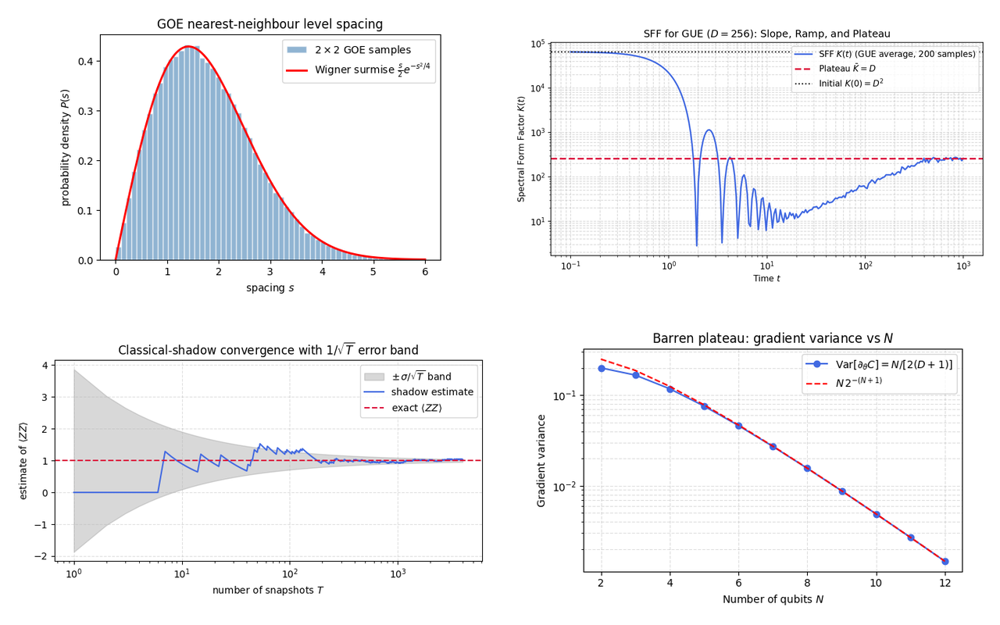
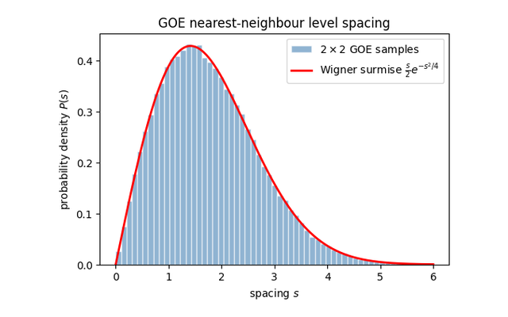
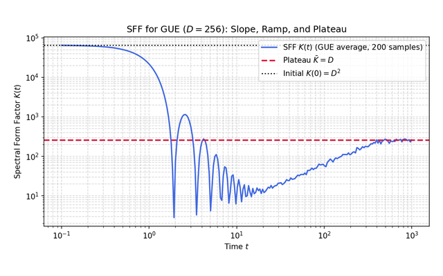
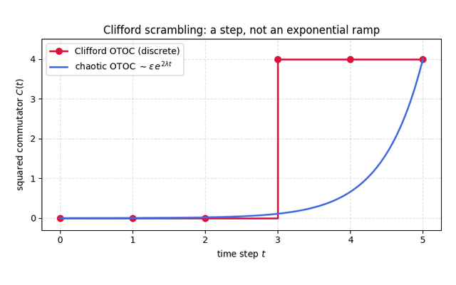
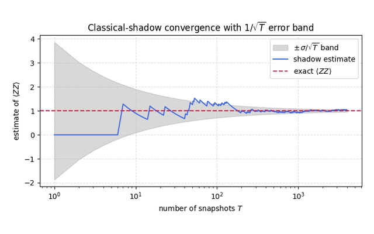

::: {.hero}
::: {.hero-text}
<h1 class="hero-title">From Haar Random States to Quantum Machine Learning</h1>

<p class="hero-tagline">A hands-on numerical tutorial on randomness, scrambling, and learning in quantum systems</p>

<p class="hero-sub">Haar averaging, the Weingarten calculus and a modest amount of representation theory, developed once and applied to quantum chaos, scrambling, benchmarking protocols and the trainability of quantum machine learning, with every step checked numerically.</p>

<p class="hero-author"><a href="https://chaos.if.uj.edu.pl/marcinplodzien/"><b>Marcin Płodzień</b></a> · Institute of Theoretical Physics, Jagiellonian University in Kraków</p>

[Start with Part 1](chapters/01-foundations.qmd){.btn .btn-primary} [Browse the parts](#parts){.btn .btn-outline-primary} [Exercises & Solutions (PDF)](exercises.qmd){.btn .btn-outline-primary}
:::

::: {.hero-image}
{fig-alt="Level repulsion in the GOE, the spectral form factor of the GUE, convergence of a classical-shadow estimate, and the barren-plateau decay of the gradient variance"}
:::
:::

## Background

A recurring lesson in quantum many-body physics and quantum information is that the
typical behaviour of a complex quantum system is sharply constrained, even when its
microscopic details are not. Averages over the unitary group, known as the Haar measure,
together with the concentration of measure that accompanies them, turn this observation
into quantitative predictions. The same low-order Haar moments then reappear in settings
that look, at first, unrelated.

The apparent thermality of a small subsystem follows from the entanglement of typical
states. The recovery of information from an evaporating black hole is governed by the
same Page-curve estimate of subsystem entropy. The protocols that certify quantum
hardware, including randomized benchmarking, cross-entropy benchmarking and classical
shadows, rest on second moments of the Haar measure. The trainability of variational
quantum circuits, through the barren-plateau phenomenon, is fixed by the same
concentration that renders typical states featureless.

The resemblance is not superficial. In each of these cases the underlying object is the
same low-order average over the unitary group, evaluated in a different physical context.
The technical core is correspondingly compact, consisting of Haar averaging, the
Weingarten calculus and a modest amount of representation theory. This tutorial develops
it once and applies it across each setting, with every step carried out explicitly and
checked numerically.

Readers who want the mathematics in more depth can consult the companion lecture notes,
[*Information Scrambling, Quantum Chaos, and Haar-Random States*](https://arxiv.org/abs/2511.14397)
(arXiv:2511.14397), which these notebooks accompany.

## What you'll learn

By the end you will be able to:

- **average over random unitaries by hand** using the Weingarten calculus, and
  predict second- and fourth-moment quantities (purity, frame potentials,
  gradient variances);
- **read the fingerprints of quantum chaos** in a spectrum: level repulsion,
  the spectral form factor, the random-matrix universality classes;
- **quantify scrambling** with out-of-time-ordered correlators, Krylov
  complexity, and tripartite mutual information;
- **use randomness as a tool**: classical shadows, randomized benchmarking, and
  the Hayden-Preskill recovery protocol;
- **explain barren plateaus** and the expressivity-trainability tension in
  quantum machine learning, from first principles.

## How the tutorial is organized {#parts}

Seven short parts, each a *concept page* followed by *runnable notebooks*:

::: {.chapter-grid}
::: {.chapter-card}
[{fig-alt="Mathematical Foundations"}](chapters/01-foundations.qmd)

[1 · Mathematical Foundations](chapters/01-foundations.qmd)

Speak the language of channels, Lie algebras, state geometry and measure theory.

<span class="nbcount">14 notebooks</span>
:::
::: {.chapter-card}
[{fig-alt="Random Matrix Theory"}](chapters/02-random-matrix-theory.qmd)

[2 · Random Matrix Theory](chapters/02-random-matrix-theory.qmd)

Diagnose chaos from a spectrum.

<span class="nbcount">4 notebooks</span>
:::
::: {.chapter-card}
[{fig-alt="Haar Measure & Weingarten Calculus"}](chapters/03-haar-weingarten.qmd)

[3 · Haar Measure & Weingarten Calculus](chapters/03-haar-weingarten.qmd)

Average over random unitaries and derive the Page formula.

<span class="nbcount">7 notebooks</span>
:::
::: {.chapter-card}
[{fig-alt="Quantum Dynamics & Chaos"}](chapters/04-dynamics.qmd)

[4 · Quantum Dynamics & Chaos](chapters/04-dynamics.qmd)

Measure scrambling in real time.

<span class="nbcount">3 notebooks</span>
:::
::: {.chapter-card}
[{fig-alt="Designs & Clifford Ensembles"}](chapters/05-designs.qmd)

[5 · Designs & Clifford Ensembles](chapters/05-designs.qmd)

Replace Haar randomness with something efficient.

<span class="nbcount">2 notebooks</span>
:::
::: {.chapter-card}
[{fig-alt="Applications of Scrambling"}](chapters/06-applications.qmd)

[6 · Applications of Scrambling](chapters/06-applications.qmd)

Turn randomness into protocols.

<span class="nbcount">5 notebooks</span>
:::
::: {.chapter-card}
[{fig-alt="Quantum Machine Learning"}](chapters/07-qml.qmd)

[7 · Quantum Machine Learning](chapters/07-qml.qmd)

Understand trainability through the same lens, then five worked examples.

<span class="nbcount">12 notebooks</span>
:::
:::

The parts are largely independent and each notebook stands on its own, so you can read in
order or jump to what you need. The second-moment twirl worked out in Part 3 recurs in the
Page formula, the classical-shadows channel, the randomized-benchmarking decay and the
barren-plateau gradient variance; where a notebook reuses an earlier result, a short
Connections note at its end points back to it. A companion
**[Exercises & Solutions PDF](exercises.qmd)** collects analytical problems and worked
solutions for every part.

## Getting started

```bash
git clone https://github.com/MarcinPlodzien/quantum-chaos-and-scrambling
cd quantum-chaos-and-scrambling
pip install -r requirements.txt
jupyter lab # open any notebook under source_notebooks/
```

Everything runs on a laptop with a standard scientific-Python stack
(`numpy`, `scipy`, `matplotlib`). No quantum hardware, no GPUs, no special libraries.

## Who this is for

Graduate students and researchers in quantum information, condensed matter, and quantum
machine learning, and anyone comfortable with linear algebra and Python who wants to
*compute* with these ideas rather than only read about them. It is meant in particular for
people learning these scattered topics on their own, where hands-on, runnable material is
hard to find. The mathematical prerequisites are light and built up as needed in Part 1.
